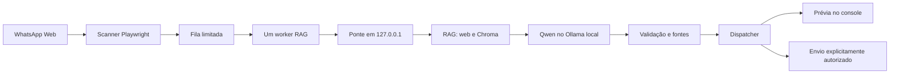

# NexoVerdict — documentação do projeto

## Finalidade

O NexoVerdict é uma tutora de educação midiática que recebe uma pergunta,
alegação ou link e organiza uma análise baseada em fontes. O usuário pode
interagir pelo terminal ou pelo bot de WhatsApp Web. A análise distingue
evidências favoráveis, contrárias, conflitantes e insuficientes, sem impor
uma classificação binária de verdadeiro ou falso.

O objetivo é explicar o que foi encontrado e oferecer referências para
investigação. Uma fonte recuperada não se torna prova só porque apareceu na
busca. Quando não há material suficiente, a saída deve declarar essa limitação.

As instruções para instalação e execução estão no [README](README.md).
Este arquivo concentra a documentação geral versionada. A pasta `docs/`
contém material local e está excluída do versionamento.

## Como a análise funciona

O sistema usa RAG: recupera documentos antes de consultar o modelo. O corpus
é fragmentado em trechos, convertido em embeddings pelo
`intfloat/multilingual-e5-small` e indexado no ChromaDB. O Qwen, servido pelo
Ollama, recebe os trechos recuperados como contexto. Atualizar o corpus ou o
índice não treina nem altera os pesos do Qwen.

No modo web, a aplicação pesquisa páginas atuais e seleciona passagens
relacionadas à alegação. Uma URL enviada é tratada como objeto da investigação:
o sistema tenta ler a página e extrair a afirmação central, em vez de usá-la
como prova de si mesma. A pesquisa também pode aproveitar evidências locais.

Os documentos são separados em duas categorias: `evidencia`, usada para
investigar fatos, e `educativo`, usada para orientar a verificação. Um guia de
leitura lateral não pode confirmar uma notícia específica.

A resposta do modelo passa por validação de estrutura, preservação da alegação,
referências numéricas e presença dos trechos literais citados no contexto.
As regras consideram relevância, qualificação e grupos de origem das fontes
para calcular `avaliacao_evidencias`. Em caso de saída inválida, o RAG pode
produzir um fallback extrativo e inconclusivo. Na ponte, falhas de transporte
do Ollama são propagadas como erro operacional.

Essas verificações não demonstram, por si só, que a conclusão está correta:
similaridade vetorial, títulos relacionados, contagem de origens e citações
bem formadas ainda exigem avaliação humana de pertinência e suporte factual.

## Componentes

| Componente | Responsabilidade |
|---|---|
| `main.py` | Menu da tutora, preparação, consultas e ferramentas experimentais |
| `rag/corpus.py` | Coleta e normalização do corpus |
| `rag/store.py` | Embeddings, indexação incremental e recuperação Chroma |
| `rag/web.py` | Busca, leitura de páginas e seleção de passagens |
| `rag/tutor.py` e `prompts/tutora_rag.txt` | Geração, validação e classificação das evidências |
| `scripts/rag_bridge.py` | API HTTP local usada pelo bot |
| `bot-test/botfinal.py` | Scanner, filas, worker RAG e dispatcher Playwright |
| `bot-test/rag_client.py` | Cliente assíncrono e formatação para WhatsApp |
| `bot-test/delivery_store.py` | Diário SQLite de processamento e envio |
| `dados/` e `scripts/` | Preparação de datasets, avaliações e versionamento experimental |

## Integração com WhatsApp

O bot e o serviço de IA rodam na mesma máquina, em processos separados.
A ponte é uma API entre esses processos; a integração com WhatsApp usa a
interface web pelo Playwright, sem API oficial do WhatsApp.

O scanner observa somente os contatos configurados. Ele confere o cabeçalho
do chat, lê mensagens recebidas dentro de `#main` e usa o ID nativo da mensagem.
Na primeira leitura de cada contato, ignora todo o histórico visível para
evitar analisar mensagens antigas após uma inicialização ou reinício.

Uma fila de entrada limitada alimenta um único worker. O scanner continua
capturando enquanto a análise acontece; a fila de saída conserva a ordem das
respostas. Não há autoscaling nem fallback Groq. Falhas geram apenas um aviso
de indisponibilidade, sujeito às mesmas regras de envio que as análises.

O dispatcher opera em dry-run por padrão. Envio real depende de ativação
explícita e da presença de todos os contatos alvo na lista autorizada. Scanner
e dispatcher compartilham um lock de navegação. O bot não substitui rascunhos.
Uma tentativa só recebe estado `sent` depois que o Playwright observa uma
bolha nova com o texto esperado e marcador de envio do WhatsApp. Isso não
significa que o destinatário leu a mensagem.

Sem confirmação, o estado fica `uncertain` e não há reenvio automático. O
diário SQLite usa um hash de chat + ID de mensagem para impedir duplicatas.
Após reinício, registros pendentes são marcados como `interrupted` e não
voltam à fila. Um lock de arquivo impede instâncias concorrentes no mesmo banco.

O bot foi importado de `Challenge-1-Residencia-IA/bot-test`, commit
`133f5223e3a2f618dc691fcf7180dcd9d7cb59b3`, e incorporado ao repositório
principal como arquivos comuns. `database.py` e seu teste são legados
preservados; o fluxo atual usa `delivery_store.py`.

## Contrato da ponte local

A ponte escuta somente em `127.0.0.1`, porta 8765 por padrão. `GET /health`
informa `schema_version`, `ready` e `busy`. A inicialização exige Ollama local,
modelo configurado instalado, cache de embeddings e ambas as coleções do índice
com documentos. Não baixa modelos durante o startup. A prontidão inicial não
garante disponibilidade futura ou qualidade das respostas.

`POST /analyze` recebe JSON com `request_id`, `message` e `history` opcional.
O identificador aceita até 80 letras ASCII, números, hífen ou sublinhado.
O texto aceita até 6000 caracteres, o corpo até 32768 bytes, e o histórico
até duas perguntas de 1000 caracteres. O bot envia histórico vazio para
evitar compartilhar conversas privadas. Campos extras são rejeitados.

Sucesso retorna `schema_version: 1`, o mesmo `request_id` e `analysis`, com o
resultado estruturado do RAG. Erros retornam `error`, nunca análise simulada.

| HTTP | Situação |
|---|---|
| 400 | JSON, campos, histórico ou identificador inválidos; padrão de dado pessoal detectado |
| 403/404 | Origem/Host rejeitado ou rota desconhecida |
| 413/415 | Entrada acima do limite ou Content-Type inadequado |
| 429 | Uma análise já está em andamento |
| 502 | Falha da análise |
| 503 | Runtime indisponível ou ainda não pronto |
| 504 | Prazo total da análise excedido |

Modelo e índice são inicializados uma vez no processo de trabalho, sem
recarregamento por mensagem. Os caches web são separados por requisição.
O prazo padrão é de 180 segundos; o cliente aguarda 200. Timeout encerra o
processo local de análise, descarta a resposta e exige reinício manual da
ponte; a geração no servidor Ollama ainda pode terminar. O `request_id`
correlaciona chamadas, mas não substitui a deduplicação do bot.

Chamadas com Origin ou Host não permitido são rejeitadas e não há CORS
habilitado. O serviço não tem autenticação: pressupõe processos locais
confiáveis e não deve ser exposto por proxy, túnel ou interface pública.

## Respostas e fontes

O contrato distingue `fontes`, efetivamente citadas, de `fontes_encontradas`,
`fontes_consultadas` e `fontes_descartadas`. O bot resolve `[n]` somente pela
lista de fontes citadas, acrescentando título, origem, data quando disponível
e URL. As demais páginas aparecem em grupos explicitamente identificados
como consultados ou descartados, sem serem promovidas a evidência.

O formatador prefere `resposta_usuario` ou `sintese`. No RAG presente neste
checkout, usa também `veredito`, `contexto` e os trechos de evidência. Ele
rejeita referências sem URL correspondente e URLs textuais ausentes dos
metadados, preservando os links recebidos nas listas de fontes.

O formatador aceita uma lista `analises`, mas o RAG atual não divide
automaticamente uma pergunta em várias alegações. Para investigar afirmações
compostas, o uso recomendado é uma por mensagem. Opinião, sátira e perguntas
ambíguas dependem da interpretação do RAG existente; a integração não
acrescenta um classificador especializado para esses casos.

## Dados, rastreamento e ferramentas de pesquisa

O corpus fica em `data/documents.jsonl`; o índice, em `vector_store/chroma/`.
Guias próprios ficam em `knowledge/`. As ferramentas de preparação trabalham
com Fake.br e FakeTrue.Br, gerando visões de evidências, casos de recuperação
e candidatos para anotação. Os dados brutos são recuperados por DVC, conforme
as permissões do armazenamento. Usar um dataset requer observar sua licença.

Casos reservados de avaliação não devem ser indexados como evidência. O
exemplo funcional do menu fica em `references/casos_avaliacao_exemplo.jsonl`;
ele não constitui, sozinho, um conjunto de avaliação representativo.

Consultas pela CLI podem registrar parâmetros, perguntas, fontes, respostas
e métricas no MLflow local. A ponte usa `track=False` para não registrar
conversas do WhatsApp. O projeto também possui ferramentas opcionais de
benchmark AVeriTeC, avaliação de recuperação/respostas, integração de datasets
e publicação no DagsHub. Nada disso é necessário para o bot funcionar e não
é iniciado automaticamente pela integração.

Os scripts de registro de modelo versionam o contrato, código e artefatos do
RAG; os pesos do Qwen permanecem gerenciados pelo Ollama. O repositório também
contém experimentos históricos de classificação e ajuste de modelos, separados
do fluxo principal da tutora.

## Privacidade e limites operacionais

As buscas web enviam a alegação a serviços externos. Um filtro conservador
bloqueia padrões de email, CPF e telefone antes da pesquisa, mas não identifica
todos os dados pessoais. Use alegações públicas sem informações privadas.
Logs HTTP da ponte são suprimidos. O diário do bot guarda hashes, estados e
datas, sem mensagens ou nomes; hashes não equivalem a anonimização.

As prévias no console podem conter conteúdo sensível. O perfil do Chromium
contém cookies e autenticação. Perfil, `.env`, índices, bancos e dados locais
ficam fora do Git. A retenção dos registros locais ainda precisa ser definida;
apagar o diário elimina a proteção de deduplicação.

O escopo inicial é texto e links em português. Mídia detectada recebe aviso de
suporte limitado, sem OCR ou transcrição. A detecção de idioma é probabilística
e não cobre textos curtos ou mistos de modo confiável. URLs inacessíveis e
falhas de serviço resultam em aviso, sem concluir que a alegação é falsa.

O WhatsApp virtualiza o DOM: mensagens que deixarem a janela renderizada antes
da captura podem não ser recuperadas, especialmente com fila cheia. Mudanças
nos seletores podem impedir captura ou confirmação. A identificação dos alvos
usa nomes exatos e exige nomes únicos; a detecção de grupos e a associação
entre cabeçalho e mensagens precisam de validação real. A integração não
oferece garantia de entrega ou captura de todo o histórico.

Respostas acima de 12000 caracteres são bloqueadas para envio, evitando cortar
uma análise e suas fontes. Continuam disponíveis integralmente na prévia.
Não há repetição automática de análise ou envio após falha. O operador deve
conferir no WhatsApp qualquer envio incerto antes de agir manualmente.

## Estado da implementação

A integração foi reconstruída em 14/10/2026. Ponte, cliente, filas, diário,
dry-run, autorização e testes simulados estão escritos. Não foram executados
testes nesta reconstrução, conforme orientação do usuário. Os resultados
históricos da versão perdida não comprovam esta implementação.

Ainda faltam os testes simulados e a validação no PC do Qwen: prontidão,
casos factuais e inconclusivos, links, mídia, falhas, reinício, filas,
identidade entre conversas e ausência de duplicatas. Envio real deve começar
com um contato autorizado, depois de revisar as prévias. Qualidade factual,
latência e estabilidade ponta a ponta permanecem sem aceite.
