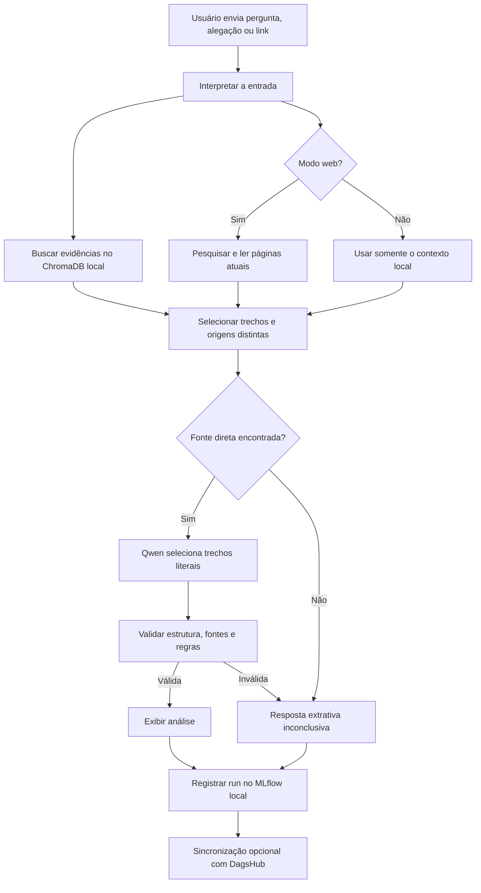

# NexoVerdict — tutora RAG para análise de evidências

O NexoVerdict é um projeto de pesquisa em educação midiática. Ele recebe uma
alegação, pergunta ou link; recupera evidências em uma base vetorial; pode
pesquisar fontes atuais na web; e usa um modelo de linguagem para organizar uma
análise rastreável.

O sistema apresenta um **veredito calibrado pelas evidências**, sem forçar uma
classificação de verdadeiro ou falso. Quando faltam fontes, ele declara que não
há evidência suficiente, descreve somente o que foi encontrado e ainda mostra
as fontes recuperadas, separando-as daquelas efetivamente usadas na análise.

O fluxo atual é um **RAG** (*Retrieval-Augmented Generation*): o modelo Qwen não
é retreinado quando o corpus muda. Novos documentos são convertidos em
embeddings, salvos no ChromaDB e enviados ao modelo como contexto no momento da
consulta.

## Sumário

- [O que o projeto faz](#o-que-o-projeto-faz)
- [Como uma resposta é produzida](#como-uma-resposta-é-produzida)
- [Arquitetura e localização dos componentes](#arquitetura-e-localização-dos-componentes)
- [Requisitos](#requisitos)
- [Instalação](#instalação)
- [Configuração](#configuração)
- [Preparação do corpus e do banco vetorial](#preparação-do-corpus-e-do-banco-vetorial)
- [Como executar](#como-executar)
- [Menu completo](#menu-completo)
- [Referência de comandos](#referência-de-comandos)
- [Formato da resposta](#formato-da-resposta)
- [MLflow local](#mlflow-local)
- [Métricas](#métricas)
- [DagsHub e versionamento compartilhado](#dagshub-e-versionamento-compartilhado)
- [O que pode ser commitado](#o-que-pode-ser-commitado)
- [Estrutura do repositório](#estrutura-do-repositório)
- [Testes](#testes)
- [Solução de problemas](#solução-de-problemas)
- [Limitações atuais](#limitações-atuais)

## O que o projeto faz

O fluxo principal:

1. recebe uma alegação, pergunta ou URL;
2. se houver uma URL, lê a publicação como objeto da investigação;
3. procura evidências no índice vetorial local;
4. no modo web, pesquisa e lê páginas atuais;
5. recupera também materiais educativos sobre verificação;
6. entrega os trechos ao Qwen pelo Ollama;
7. valida o JSON produzido e verifica se as citações pertencem ao contexto;
8. descarta respostas inválidas e apresenta trechos literais com as fontes encontradas;
9. calcula o veredito com regras de citação, relevância e independência das fontes;
10. registra fontes, parâmetros, métricas e artefatos no MLflow local.

As evidências factuais e os materiais educativos são separados. Um guia sobre
leitura lateral pode ensinar **como** investigar, mas não pode ser usado como
prova de que uma alegação específica ocorreu.

### O que o projeto não faz

- não treina os pesos do Qwen ao atualizar o RAG;
- não usa o antigo classificador binário do Fake.br para decidir a análise;
- não transforma a publicação enviada pelo usuário em prova de si mesma;
- não garante que toda página da web estará acessível;
- não substitui revisão humana em avaliações de qualidade ou decisões sensíveis.

## Como uma resposta é produzida



Na busca vetorial, cada texto e cada pergunta são convertidos em vetores pelo
`intfloat/multilingual-e5-small`. O ChromaDB usa distância de cosseno: **quanto
menor a distância, mais próximo semanticamente o trecho está da consulta**.
Uma distância pequena indica semelhança textual ou semântica; sozinha, ela não
prova relevância factual nem qualidade da fonte.

## Arquitetura e localização dos componentes

| Componente | Tecnologia | Onde roda ou fica |
|---|---|---|
| Modelo gerador | `qwen2.5:7b` | Ollama na máquina do usuário |
| Pesos do Qwen | Ollama | Cache local do Ollama; não ficam no Git |
| Modelo de embeddings | `intfloat/multilingual-e5-small` | Cache local do Hugging Face |
| Banco vetorial | ChromaDB | `vector_store/chroma/` |
| Corpus normalizado | JSONL | `data/documents.jsonl` |
| Prompt principal | Texto versionado | `prompts/tutora_rag.txt` |
| Validação da resposta | Python | `rag/tutor.py` |
| Política de busca web | JSON versionado | `web_sources.json` |
| Rastreamento cotidiano | MLflow + SQLite | `mlflow.db` e `mlartifacts/` |
| Runs compartilhados | MLflow do DagsHub | servidor remoto do projeto |
| Código | Git | GitHub e remoto Git do DagsHub |

O artefato de modelo registrado no DagsHub contém o código do RAG, prompt,
esquema, corpus, índice e referências exatas às dependências. Os pesos do Qwen
não são copiados; a versão registra seu nome e digest para conferência.

## Requisitos

- macOS ou Linux;
- Git;
- Python 3.11 ou 3.12;
- [Ollama](https://ollama.com/) instalado;
- espaço em disco para Qwen, embeddings, corpus e índice;
- internet para instalação, download, modo web e DagsHub.

O modo local funciona sem pesquisa web depois que dependências, modelos e índice
estiverem disponíveis na máquina.

## Instalação

### 1. Clonar o projeto

```bash
git clone https://github.com/Challenge-1-Residencia-IA/experimentos.git
cd experimentos
git checkout feat/rag
```

### 2. Criar e ativar o ambiente virtual

```bash
python3.11 -m venv .venv
source .venv/bin/activate
python -m pip install --upgrade pip
```

Se `python3.11` não existir, use `python3` e confirme a versão com
`python --version`.

### 3. Instalar as dependências do RAG

```bash
pip install -r requirements-rag.txt
```

O arquivo `requirements.txt` atende experimentos antigos de preparação de dados,
classificação e fine-tuning. Para executar a tutora, use
`requirements-rag.txt`.

Para preparar os datasets em Parquet ou executar a suíte de testes, instale
também as dependências de desenvolvimento:

```bash
pip install -r requirements.txt
```

Esse segundo arquivo inclui `pandas`, `pyarrow`, `scikit-learn` e `pytest`, além
das dependências dos experimentos históricos com MLX.

### 4. Preparar as variáveis locais

```bash
cp .env.example .env
```

Edite `.env` somente na sua máquina. O arquivo é ignorado pelo Git.

### 5. Instalar o modelo no Ollama

```bash
ollama pull qwen2.5:7b
ollama list
```

Se o aplicativo Ollama não estiver atendendo requisições:

```bash
ollama serve
```

## Configuração

Exemplo de `.env`:

```dotenv
OLLAMA_MODEL=qwen2.5:7b
OLLAMA_URL=http://localhost:11434/api/chat
MLFLOW_EXPERIMENT_NAME=NexoVerdict-RAG
DAGSHUB_REPO=FilipeLacerda738/experimentos
MLFLOW_TRACKING_USERNAME=seu_usuario_dagshub
MLFLOW_TRACKING_PASSWORD=seu_token_dagshub
FACT_CHECK_API_KEY=
```

| Variável | Obrigatória | Uso |
|---|---:|---|
| `OLLAMA_MODEL` | não | Modelo gerador; padrão `qwen2.5:7b` |
| `OLLAMA_URL` | não | Endpoint da API local do Ollama |
| `MLFLOW_EXPERIMENT_NAME` | não | Nome do experimento; padrão `NexoVerdict-RAG` |
| `MLFLOW_TRACKING_URI` | não | Substitui o banco MLflow local padrão |
| `MLFLOW_TRACKING_USERNAME` | para DagsHub | Usuário do DagsHub |
| `MLFLOW_TRACKING_PASSWORD` | para DagsHub | Token de acesso do DagsHub |
| `DAGSHUB_REPO` | para DagsHub | Repositório no formato `usuario/repositorio` |
| `FACT_CHECK_API_KEY` | somente opção 4 | Google Fact Check Tools API |

Nunca coloque token, senha ou conteúdo real do `.env` em commits, prints,
issues ou mensagens.

## Preparação do corpus e do banco vetorial

Há dois caminhos. O primeiro cria uma base mínima com os guias versionados. O
segundo prepara o corpus factual usado nos experimentos com FakeTrue.Br.

### Caminho A: base educativa mínima

O `sources.json` atual contém dois materiais próprios:

- `knowledge/leitura_lateral.md`;
- `knowledge/evidencias_e_contexto.md`.

Colete e indexe:

```bash
python -m scripts.coletar_rag --config sources.json
python -m scripts.indexar_rag
```

Essa base ensina o método, mas não contém evidências suficientes para responder
à maioria das alegações factuais. Para essas consultas, use o modo web ou monte
o corpus factual.

### Caminho B: corpus factual preparado

Os arquivos brutos esperados são:

```text
data/raw/Fake.br-Corpus/
data/raw/FakeTrue.Br/FakeTrueBr_corpus.csv
```

Os dados brutos não estão no Git. Cada integrante deve obtê-los pelas fontes
autorizadas e respeitar as licenças e condições de uso.

Prepare as visões intermediárias:

```bash
python -m dados.preparar
```

Esse comando gera:

| Arquivo | Finalidade |
|---|---|
| `data/interim/textos.parquet` | Camada harmonizada dos datasets |
| `data/processed/base_checagens.parquet` | Evidências factuais para o RAG |
| `data/processed/avaliacao_busca.parquet` | Casos com URLs esperadas para avaliação |
| `data/processed/golden_set_candidatos.parquet` | Candidatos para anotação humana |
| `data/processed/fewshot_candidatos.parquet` | Candidatos para experimentos antigos |

Converta as visões adequadas ao formato do RAG:

```bash
python -m scripts.converter_dataset_colega_rag
```

Saídas principais:

| Arquivo | Uso |
|---|---|
| `data/documents.jsonl` | Corpus lido pelo indexador |
| `data/avaliacao/casos_dataset_colega.jsonl` | Casos de recuperação |
| `data/manifest_rag.json` | Contagens, hashes e validações da conversão |

O conversor preserva os materiais educativos existentes. Para substituí-los,
use `--nao-preservar-educativos` conscientemente.

Por fim, atualize o índice:

```bash
python -m scripts.indexar_rag
```

O indexador é incremental: mantém documentos inalterados, atualiza os que
mudaram e remove chunks obsoletos.

### Regra de separação dos dados

- `base_checagens.parquet` pode alimentar o corpus factual;
- `avaliacao_busca.parquet` serve para medir recuperação;
- golden set e casos reservados não devem ser indexados como evidência;
- textos classificados como desinformação não entram na base como prova factual.

Essa separação evita avaliar a resposta com documentos que ela já recebeu como
contexto.

## Como executar

### Interface principal

```bash
python main.py
```

```bash
# Lista as opções e encerra
python main.py --listar

# Abre diretamente uma opção
python main.py --opcao 3

# Mostra traceback completo em caso de erro
python main.py --debug
```

### Perguntar com busca local e web

Ao usar a opção 3 do menu, o programa pergunta primeiro o nome do experimento
MLflow. Todas as perguntas daquela conversa ficam agrupadas nesse experimento.
Ao digitar `sair`, a configuração anterior é restaurada.

Exemplo:

```text
Nome do experimento no MLflow (NexoVerdict-RAG): teste-prompt-v2
```

Para consultas diretas por linha de comando, o nome continua vindo de
`MLFLOW_EXPERIMENT_NAME` no `.env`.

```bash
python -m scripts.perguntar_rag "O governo vai proibir X em outubro?"
```

Esse é o modo recomendado para alegações atuais.

### Perguntar somente ao RAG local

```bash
python -m scripts.perguntar_rag \
  "O governo vai proibir X em outubro?" \
  --local
```

O modo local é mais reproduzível, porém limitado ao corpus indexado.

### Investigar um link

```bash
python -m scripts.perguntar_rag \
  "Analise a alegação principal desta publicação: https://exemplo.org/noticia"
```

A publicação enviada é o objeto da investigação. O sistema ainda procura
evidências externas.

## Menu completo

| Opção | Ação | Resultado |
|---:|---|---|
| 1 | Coletar documentos | Normaliza as fontes de `sources.json` no corpus |
| 2 | Atualizar banco vetorial | Gera embeddings e atualiza o ChromaDB |
| 3 | Conversar com a tutora | Pede o nome do experimento e inicia conversa local + web |
| 4 | Descobrir checagens | Salva URLs candidatas para revisão humana |
| 5 | Avaliar recuperação | Mede Hit@K e MRR com URLs esperadas |
| 6 | Ver estado da base | Mostra corpus, índice, MLflow e modelo |
| 7 | Avaliar respostas | Executa casos e registra métricas no MLflow |
| 8 | Benchmark AVeriTeC | Prepara e executa o benchmark separado |
| 9 | Abrir MLflow local | Inicia a interface web local |
| 10 | Integrar novos datasets | Fluxo experimental para datasets adicionais |
| 11 | Teste temporário | Usa um banco MLflow descartável |
| 12 | Testar versão registrada | Carrega uma versão do Registry do DagsHub |
| 13 | Publicar no DagsHub | Publica modelo, datasets ou ambos |
| 14 | Ver DagsHub | Mostra a URL do servidor remoto |
| 0 | Sair | Encerra o programa |

Ao abrir a opção 3, o projeto pede o nome do experimento MLflow e verifica se
`sources.json` mudou ou se a última atualização ocorreu há mais de 24 horas.
Quando necessário, coleta as fontes e atualiza o índice. Isso atualiza
documentos e embeddings; não treina o Qwen.

## Referência de comandos

Execute os comandos na raiz do repositório, com a `.venv` ativada.

### Coleta e indexação

```bash
python -m scripts.coletar_rag --config sources.json
python -m scripts.indexar_rag

python -m scripts.indexar_rag \
  --corpus-path data/documents.jsonl \
  --index-path vector_store/chroma
```

### Conversão do dataset preparado

```bash
python -m scripts.converter_dataset_colega_rag \
  --evidencias data/processed/base_checagens.parquet \
  --avaliacao data/processed/avaliacao_busca.parquet \
  --interim data/interim/textos.parquet \
  --saida-corpus data/documents.jsonl \
  --saida-casos data/avaliacao/casos_dataset_colega.jsonl \
  --manifesto data/manifest_rag.json
```

Enquanto a condição de uso não estiver confirmada, mantenha o padrão
`--license verificar`. Depois da revisão documental, informe a licença correta:

```bash
python -m scripts.converter_dataset_colega_rag --license "LICENCA_CONFIRMADA"
```

O valor deve descrever a condição real. Não use um nome fictício apenas para
liberar publicação remota.

### Consultas

```bash
# Base local + web
python -m scripts.perguntar_rag "Sua alegação"

# Somente base local
python -m scripts.perguntar_rag "Sua alegação" --local

# Banco MLflow temporário
python -m scripts.perguntar_rag \
  "Sua alegação" \
  --local \
  --mlflow-local /tmp/nexoverdict-mlflow-teste
```

### Descoberta de checagens candidatas

Exige `FACT_CHECK_API_KEY` no `.env`:

```bash
python -m scripts.descobrir_checagens \
  "tema ou alegação" \
  --paginas 2 \
  --saida data/candidatas_checagens.jsonl
```

O comando somente cria uma lista para revisão. Ele não adiciona as URLs ao
índice. Revise fonte, conteúdo e licença; depois inclua uma fonte aprovada no
`sources.json`, colete e indexe.

### Avaliação rápida da recuperação

```bash
python -m scripts.avaliar_recuperacao_rag \
  data/avaliacao/casos_dataset_colega.jsonl \
  --k 6
```

Formato mínimo de cada linha do JSONL:

```json
{"id":"caso-1","pergunta":"alegação a buscar","urls_esperadas":["https://fonte.example/checagem"]}
```

### Avaliação rastreada no MLflow

Apenas recuperação, sem chamar o Qwen:

```bash
python -m scripts.avaliar_rag_mlflow \
  data/avaliacao/casos_dataset_colega.jsonl \
  --retrieval-only \
  --run-name avaliacao-recuperacao-v1
```

Avaliação completa, com no máximo uma geração do Qwen por caso e resposta
extrativa quando a saída não passa na validação:

```bash
python -m scripts.avaliar_rag_mlflow \
  data/avaliacao/casos_dataset_colega.jsonl \
  --run-name avaliacao-respostas-v1
```

Esse segundo comando pode demorar bastante. O programa imprime cada caso
concluído. Para um teste curto, crie um JSONL pequeno e passe seu caminho.

O arquivo também pode conter:

```json
{"id":"caso-2","pergunta":"alegação","urls_esperadas":[],"espera_sem_evidencia":true,"avaliacao_revisada":"EVIDENCIAS_INSUFICIENTES"}
```

`avaliacao_revisada` precisa ser anotada por uma pessoa e deve usar uma das
categorias aceitas pelo contrato de resposta.

### Recalcular métricas de consultas antigas

```bash
python -m scripts.recalcular_metricas_mlflow
```

O script aproveita os artefatos existentes. Ele não consegue gerar dados que
não foram salvos em runs antigos.

### Benchmark AVeriTeC

Preparar sem executar o modelo:

```bash
python -m scripts.testar_benchmark_averitec \
  --per-class 10 \
  --seed 42 \
  --prepare-only
```

Executar o benchmark completo:

```bash
python -m scripts.testar_benchmark_averitec \
  --per-class 10 \
  --seed 42
```

O benchmark usa arquivos e índice separados do corpus principal. A execução
completa pode ser longa e chama o Qwen para todos os casos amostrados.

### Integração experimental de outros datasets

```bash
python -m scripts.integrar_datasets \
  --dataset averitec \
  --limit 40 \
  --max-words 180 \
  --overlap 35 \
  --inject-context
```

Valores de `--dataset`: `fakerecogna`, `xfact`, `averitec`, `fakebr` ou
`todos`. Use `--overwrite` somente quando quiser substituir o corpus de saída.

Esse fluxo é experimental. Revise licença, natureza do texto e finalidade antes
de indexar qualquer conjunto. Textos falsos do Fake.br não devem ser
apresentados ao RAG como evidência factual confiável.

## Formato da resposta

O contrato atual é `analise-evidencias-v5`. A interface apresenta:

```text
ANÁLISE

Afirmação:
"O governo vai proibir X em outubro."

Veredito:
Não há fontes suficientes para confirmar ou refutar esta afirmação. Abaixo
está o que foi encontrado, sem transformar informações incompletas em uma
conclusão.

O que foi encontrado (quando não há citação literal validada):
• Trechos literais das fontes recuperadas, claramente separados de uma conclusão.

Evidências favoráveis:
• Evidência factual citada e ligada a uma fonte.

Evidências contrárias:
• Evidência factual que contradiz ou limita a afirmação.

Contexto:
Quantidade de fontes recuperadas e de fontes diretamente relacionadas.

Pontos de atenção:
• O título da fonte não confirma sozinho o conteúdo.

Avaliação das evidências:
🟡 Evidências conflitantes

Limitações:
Não foram encontradas fontes primárias suficientes.

Fontes encontradas, não usadas como evidência:
• Título, origem e URL de cada fonte recuperada.
```

Categorias possíveis:

| Código | Exibição | Quando usar |
|---|---|---|
| `EVIDENCIAS_CONFLITANTES` | 🟡 Evidências conflitantes | Fontes relevantes sustentam leituras incompatíveis |
| `EVIDENCIAS_SUFICIENTES_FAVORAVEIS` | 🟢 Evidências favoráveis consistentes | Há suporte factual qualificado e suficiente |
| `EVIDENCIAS_SUFICIENTES_CONTRARIAS` | 🔴 Evidências contrárias consistentes | Há contradição factual qualificada e suficiente |
| `EVIDENCIAS_INSUFICIENTES` | ⚪ Evidências insuficientes / inconclusivas | Faltam fontes, independência ou conteúdo verificável |
| `NAO_APLICAVEL` | 🔘 Não aplicável | A entrada não contém alegação factual verificável |

O Qwen devolve apenas a alegação e listas de trechos literais citados. O código
confere se a alegação foi preservada, se cada citação aponta para uma fonte
diretamente relacionada e se o trecho aparece literalmente nela. Contexto,
limitações, lista de fontes e categoria do veredito são montados pelo código.
Uma conclusão favorável ou contrária exige dois grupos de origem qualificados
e independentes que o modelo tenha citado no mesmo sentido. A pertinência e a
interpretação dos trechos ainda precisam de revisão humana. Fontes relacionadas
continuam visíveis mesmo quando não são usadas no veredito; resultados sem
relação com a alegação ficam somente no rastreio técnico.

## MLflow local

Por padrão, cada consulta é registrada automaticamente em:

```text
sqlite:////caminho/do/projeto/mlflow.db
```

Os artefatos ficam em `mlartifacts/rag/`. Para abrir a interface:

```bash
python -m mlflow ui \
  --backend-store-uri "sqlite:///$(pwd)/mlflow.db" \
  --port 5000
```

Acesse <http://127.0.0.1:5000>. Para encerrar, pressione `Ctrl+C`.

### O que uma consulta registra

- versão e hash do prompt;
- hash do esquema JSON e do validador;
- commit Git;
- modelo Ollama configurado;
- pergunta original;
- documentos recuperados e distâncias;
- contexto de execução, incluindo modo local ou web;
- a tentativa bruta de geração e eventuais correções locais de rótulos;
- erros de validação;
- resposta final validada;
- categoria de avaliação;
- métricas de recuperação, fontes, geração e latência;
- vínculo com versão registrada, quando contrato e corpus coincidem.

### Teste temporário

```bash
python -m scripts.perguntar_rag \
  "Sua pergunta" \
  --local \
  --mlflow-local /tmp/nexoverdict-mlflow-teste
```

Para abrir esse banco separado:

```bash
python -m mlflow ui \
  --backend-store-uri sqlite:////tmp/nexoverdict-mlflow-teste/mlflow.db \
  --port 5001
```

## Métricas

### Métricas por consulta

| Métrica | Interpretação |
|---|---|
| `resposta_valida` | A resposta final passou pelo esquema e pelas regras |
| `documentos_recuperados` | Total de trechos entregues à resposta |
| `evidencias_recuperadas` | Documentos factuais recuperados |
| `materiais_educativos_recuperados` | Guias metodológicos recuperados |
| `documentos_citados` | Documentos usados na resposta final |
| `evidencias_citadas` | Evidências factuais citadas |
| `fontes_independentes_citadas` | Grupos de origem distintos citados |
| `taxa_documentos_citados` | Fração do contexto recuperado que foi citada |
| `distancia_vetorial_min/media/max` | Distâncias recuperadas; menor é mais próximo |
| `resultados_web` | Resultados retornados pela pesquisa web |
| `paginas_web_lidas` | Páginas que puderam ser extraídas |
| `fontes_web_qualificadas` | Fontes que atendem à política configurada |
| `latencia_recuperacao_s` | Tempo gasto para recuperar contexto |
| `latencia_geracao_s` | Tempo gasto pelo Qwen |
| `latencia_total_s` | Tempo da consulta, incluindo pesquisa web, seleção e geração |
| `cache_hit` | A pergunta e o histórico recente foram atendidos pelo cache da conversa |
| `tentativas_geracao` | Zero sem fonte direta; caso contrário, no máximo uma chamada ao modelo |
| `primeira_resposta_valida` | Indica se a primeira saída passou na validação |
| `correcao_automatica_sucesso` | Rótulos soltos como `E4` foram removidos e convertidos em achados literais, sem nova geração |
| `fallback_seguro` | Foi necessário devolver a resposta conservadora |
| `afirmacao_original_preservada` | A resposta manteve a alegação enviada |

### Métricas de avaliação em lote

| Métrica | Interpretação |
|---|---|
| `casos` | Total de casos processados |
| `casos_com_erro` / `taxa_erros` | Falhas técnicas no lote |
| `latencia_media_s` | Tempo médio por caso |
| `hit_at_6` | Casos em que uma URL esperada apareceu entre as seis primeiras |
| `mrr` | Premia a URL esperada quando aparece mais perto da primeira posição |
| `precision_at_6` | Fração dos resultados que coincide com URLs esperadas |
| `recall_at_6` | Fração das URLs esperadas que foi encontrada |
| `ndcg_at_6` | Qualidade da ordem dos resultados relevantes |
| `taxa_documentos_irrelevantes_at_6` | `1 - precision_at_6` no gabarito de URLs |
| `taxa_respostas_validas` | Respostas que passaram pela validação |
| `concordancia_avaliacao` | Concordância com rótulos revisados por humanos |
| `taxa_abstencao_correta` | Acerto em casos que deveriam ficar inconclusivos |
| `taxa_resposta_inconclusiva_casos_reservados` | Comportamento em casos sem evidência na base |

`Hit@6 = 0,78` significa que uma URL esperada apareceu nos seis primeiros
resultados em 78% dos casos avaliáveis. Isso **não significa 78% de precisão do
modelo**. A qualidade final exige casos independentes, rótulos humanos e análise
das respostas.

O gabarito atual é estrito por URL. Uma fonte alternativa correta pode ser
contada como irrelevante se sua URL não estiver na lista esperada. Interprete
Precision@6 e a taxa de irrelevantes com essa limitação.

## DagsHub e versionamento compartilhado

O projeto usa duas formas diferentes de versionamento:

| Canal | O que guarda |
|---|---|
| GitHub / Git do DagsHub | Código, prompt, configuração, documentação e testes |
| MLflow do DagsHub | Runs, métricas, parâmetros, artefatos aprovados e versões do RAG |

Endpoint configurado:

```text
https://dagshub.com/FilipeLacerda738/experimentos.mlflow
```

Cada colega configura seu próprio usuário e token no `.env`.

### Sincronizar os runs locais atuais

Primeiro, veja o que seria enviado:

```bash
python -m scripts.sincronizar_runs_mlflow_dagshub --dry-run
```

Depois, sincronize:

```bash
python -m scripts.sincronizar_runs_mlflow_dagshub
```

Enviar somente runs específicos:

```bash
python -m scripts.sincronizar_runs_mlflow_dagshub \
  --run-id ID_DO_RUN_1 \
  --run-id ID_DO_RUN_2
```

Usar outro banco ou experimento:

```bash
python -m scripts.sincronizar_runs_mlflow_dagshub \
  --local-db /caminho/mlflow.db \
  --experiment-name NexoVerdict-RAG
```

O sincronizador reconhece runs enviados pela tag `source_local_run_id`. Use
`--force` somente para criar outra cópia. Por segurança de licença, ele envia
métricas, histórico, parâmetros, tags e um resumo; não envia artefatos que
possam conter texto do corpus.

### Versionar o contrato de resposta

```bash
python -m scripts.versionar_resposta_mlflow
```

Esse comando registra no DagsHub o prompt, esquema JSON, validador, hashes,
dependências relevantes e commit Git.

### Registrar o RAG no Model Registry

```bash
python -m scripts.registrar_modelo_rag_mlflow
```

O registro exige:

- corpus e ChromaDB presentes;
- Ollama ativo e modelo instalado;
- revisão local identificável do modelo de embeddings;
- credenciais do DagsHub;
- licença ou condição de uso revisada para todos os documentos.

O nome registrado é `NexoVerdict-RAG-Analise-Evidencias`.

### Publicar os datasets aprovados

```bash
python -m scripts.publicar_dataset_rag_mlflow
```

O publicador cria um manifesto com hashes, tamanhos, quantidades e licenças. Se
algum documento tiver `license=verificar`, `não informada` ou vazia, a
publicação será bloqueada. Isso é intencional.

### Testar uma versão registrada

```bash
python -m scripts.testar_modelo_dagshub \
  "É verdade que esta alegação aconteceu?" \
  --version 1 \
  --modo web
```

Para usar somente o índice empacotado:

```bash
python -m scripts.testar_modelo_dagshub \
  "É verdade que esta alegação aconteceu?" \
  --version 1 \
  --modo local
```

## O que pode ser commitado

### Deve ser versionado no Git

- código em `rag/`, `scripts/` e `dados/`;
- prompt em `prompts/`;
- testes em `tests/`;
- documentação em `README.md` e `docs/`;
- configurações sem segredos, como `.env.example`, `sources.json` e
  `web_sources.json`;
- materiais próprios ou redistribuíveis com licença confirmada;
- pequenos resultados agregados que ajudam a reproduzir decisões.

### Não deve ser commitado

- `.env`, tokens, senhas e chaves;
- datasets brutos ou processados sem permissão explícita;
- `data/documents.jsonl` com material restrito;
- `vector_store/` e outros índices gerados;
- `mlflow.db`, `mlartifacts/` e caches;
- pesos do Qwen e caches do Hugging Face;
- checkpoints, adaptadores e logs grandes;
- arquivos temporários e ambientes virtuais.

O `.gitignore` já cobre esses itens. Antes de um commit, confira:

```bash
git status --short
git diff --check
git diff
```

Para publicar código nos dois remotos:

```bash
git add README.md docs rag scripts dados tests prompts sources.json web_sources.json
git commit -m "docs: atualiza documentação do RAG"
git push origin feat/rag
git push dagshub feat/rag
```

Revise a lista do `git add`; adapte o comando aos arquivos realmente alterados.

## Estrutura do repositório

```text
experimentos/
├── main.py                         # Menu principal
├── rag/
│   ├── corpus.py                   # Coleta, normalização e corpus
│   ├── store.py                    # ChromaDB, embeddings e busca
│   ├── tutor.py                    # Prompt, Qwen, validação e MLflow
│   ├── web.py                      # Pesquisa e leitura segura da web
│   ├── metrics.py                  # Métricas por consulta
│   ├── auto_refresh.py             # Atualização automática da base
│   ├── dagshub_tracking.py         # MLflow local e remoto
│   └── mlflow_model.py             # Pacote MLflow PyFunc do RAG
├── scripts/                        # Entradas de linha de comando
├── dados/                          # Preparação de Fake.br e FakeTrue.Br
├── prompts/
│   └── tutora_rag.txt              # Contrato de comportamento
├── knowledge/                      # Materiais versionados
├── tests/                          # Testes automatizados
├── docs/                           # Guias e relatórios técnicos
├── sources.json                    # Fontes do corpus automático
├── web_sources.json                # Política de domínios da web
├── requirements-rag.txt            # Dependências do fluxo atual
├── requirements.txt                # Dependências de fluxos antigos
├── .env.example                    # Configuração sem segredos
├── data/                            # Dados gerados ou locais, ignorados
├── vector_store/chroma/            # Índice local, ignorado
├── mlflow.db                       # Banco de runs local, ignorado
└── mlartifacts/                    # Artefatos locais, ignorados
```

## Testes

Os testes automatizados cobrem preparação textual, conversão do dataset,
recuperação, métricas e robustez do contrato da tutora.

```bash
python -m pytest tests
```

Executar somente os testes rápidos do contrato e das métricas:

```bash
python -m pytest \
  tests/test_tutor_robustness.py \
  tests/test_avaliar_rag_mlflow.py
```

Os testes unitários não substituem uma avaliação com casos revisados.
Avaliações em lote e benchmarks devem ser executados separadamente, pois podem
baixar dados, gerar embeddings ou chamar o Qwen muitas vezes.

## Solução de problemas

### `Connection refused` ou falha ao chamar o Ollama

```bash
ollama list
ollama serve
ollama pull qwen2.5:7b
```

Confirme também `OLLAMA_URL` e `OLLAMA_MODEL` no `.env`.

### `Arquivo de avaliação não encontrado`

O caminho informado precisa existir. Use o exemplo versionado:

```bash
python -m scripts.avaliar_rag_mlflow \
  docs/casos_avaliacao_exemplo.jsonl \
  --run-name teste-exemplo
```

Ou gere o arquivo completo com o conversor e use
`data/avaliacao/casos_dataset_colega.jsonl`.

### `Banco vetorial ausente`

```bash
python -m scripts.coletar_rag --config sources.json
python -m scripts.indexar_rag
```

Se estiver usando o dataset preparado, execute o conversor antes da indexação.

### As métricas não aparecem no MLflow

1. confira se a saída do comando mostra um `run_id`;
2. abra a interface apontando para o mesmo `mlflow.db`;
3. confirme que `MLFLOW_TRACKING_URI` no `.env` não aponta para outro banco;
4. selecione o experimento `NexoVerdict-RAG`;
5. abra a aba de métricas do run ou selecione métricas para criar gráficos.

### A pesquisa web não encontrou fontes

A busca depende de serviços externos. Sites podem bloquear automação, remover
páginas ou responder lentamente. O sistema continua com o índice local e deve
explicitar a limitação na resposta.

`web_sources.json` contém domínios aptos a contribuir para análises mais fortes
e domínios que não devem ser lidos automaticamente. As listas são regras de
triagem e ainda exigem revisão humana.

### Erro de autenticação no DagsHub

Confira sem imprimir o valor do token:

```bash
grep '^DAGSHUB_REPO=' .env
grep '^MLFLOW_TRACKING_USERNAME=' .env
grep '^MLFLOW_TRACKING_PASSWORD=' .env
```

Cada colaborador deve usar seu próprio token. Se ele tiver sido exposto,
revogue-o no DagsHub e gere outro.

### Publicação bloqueada por `license=verificar`

Confirme a licença ou condição de uso na origem do dataset. Depois reconverta o
corpus com o valor correto. Essa pendência não impede a sincronização apenas das
métricas e dos parâmetros dos runs locais.

### Downloads do Hugging Face falham, mas o modelo já está em cache

```bash
HF_HUB_OFFLINE=1 TRANSFORMERS_OFFLINE=1 \
python -m scripts.perguntar_rag "Sua pergunta" --local
```

Esse modo só funciona quando todos os arquivos necessários já estão no cache.

## Limitações atuais

- A qualidade depende da cobertura do corpus e da disponibilidade da web.
- Similaridade vetorial não garante que um documento responda corretamente à
  alegação.
- A lista de domínios é uma heurística, não uma avaliação editorial definitiva.
- Páginas dinâmicas, protegidas ou muito grandes podem não ser lidas.
- O modo web muda com o tempo e é menos reproduzível que o modo local.
- O gabarito de recuperação por URL pode penalizar fontes alternativas válidas.
- A avaliação só mede concordância real quando há rótulos humanos.
- O RAG não se auto treina; melhorar o corpus não altera os pesos do Qwen.
- A licença do corpus FakeTrue.Br precisa ser confirmada antes de publicar seus
  textos ou o índice remoto.

## Documentação complementar

- [Tutora RAG](docs/RAG_TUTORA.md): detalhes técnicos e protocolo de uso.
- [Plano de conversão](docs/PLANO_CONVERSAO_DATASET_RAG.md): decisões sobre as
  visões do dataset.
- [Versionamento no DagsHub](docs/VERSIONAMENTO_DAGSHUB.md): autenticação,
  registro e sincronização.
- [Como o benchmark foi feito](docs/BENCHMARK_RAG_COMO_FOI_FEITO.md): preparação
  do AVeriTeC.
- [Resultados do benchmark](docs/BENCHMARK_RAG_RESULTADOS.md): resultados
  históricos e limitações.

Alguns documentos registram experimentos anteriores. Em caso de diferença, o
contrato `analise-evidencias-v5`, este README e o código atual do branch
`feat/rag` descrevem o fluxo em uso.
