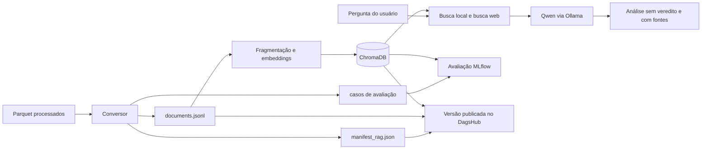

# Plano de conversão do dataset para o RAG

Status: **implementado e executado em 6 de outubro de 2026**.

Este documento define quais dados entram no RAG, quais ficam reservados para
avaliação e o fluxo necessário para gerar o corpus, atualizar o ChromaDB,
testar e publicar uma nova versão no DagsHub.

## Decisão

### Dataset usado como evidência

Usar `data/processed/base_checagens.parquet` como a base factual local do RAG.
Ele é a melhor opção disponível porque contém textos verdadeiros já limpos,
URLs de origem, domínio, ano e o tipo do texto. A preparação atual produziu
1.075 linhas: 655 checagens e 420 notícias.

Os dois tipos podem entrar na coleção `evidencias`. O campo `natureza` deve ser
preservado para auditoria. O agrupamento de origem deve representar o grupo
editorial, para que páginas do mesmo grupo não sejam contadas como fontes
independentes.

### Dataset usado para avaliação

Usar `data/processed/avaliacao_busca.parquet` apenas para gerar casos de teste.
Ele contém 1.791 alegações e a URL da checagem esperada:

- 1.440 casos cuja checagem foi mantida em `base_checagens.parquet`;
- 351 casos cuja checagem foi deliberadamente retirada da base, úteis para
  avaliar ausência de evidência e abstenção.

Esse arquivo não deve ser indexado. Colocar as alegações de teste ou suas
respostas no banco vetorial causaria vazamento entre avaliação e recuperação.

### Dados que não entram no índice factual

- `data/processed/fewshot_candidatos.parquet`: contém textos de desinformação e
  só pode ser usado, após revisão, como exemplo de entrada para prompt.
- `data/interim/textos.parquet`: é uma camada intermediária que mistura
  checagens, notícias e desinformação.
- `data/processed/golden_set_candidatos.parquet`: permanece reservado para
  anotação e avaliação humana, conforme solicitado.

Os materiais educativos configurados em `sources.json` continuam em uma
coleção separada, `materiais_educativos`. Eles ensinam o método de verificação,
mas não contam como evidência factual da alegação.

## Script implementado

O arquivo `scripts/converter_dataset_colega_rag.py` converte os dois
Parquet para os formatos já lidos pelo projeto, sem gerar embeddings dentro da
conversão.

Interface planejada:

```bash
python -m scripts.converter_dataset_colega_rag \
  --evidencias data/processed/base_checagens.parquet \
  --avaliacao data/processed/avaliacao_busca.parquet \
  --saida-corpus data/documents.jsonl \
  --saida-casos data/avaliacao/casos_dataset_colega.jsonl \
  --manifesto data/manifest_rag.json
```

O script deve aceitar também uma opção para preservar os documentos
`educativo` já existentes no corpus. A escrita deve ser atômica: criar um
arquivo temporário, validar o resultado e só então substituir o destino.

### Conversão de `base_checagens.parquet`

Cada linha deve gerar um documento no formato de `rag.corpus.read_corpus`:

```json
{
  "id": "hash-estavel-da-url",
  "kind": "evidencia",
  "source": "nome-legivel-da-fonte",
  "origin_group": "grupo-editorial-normalizado",
  "url": "https://fonte/...",
  "title": "titulo-recuperado-ou-descricao-segura",
  "published_at": "2023",
  "license": "licenca-ou-condicao-de-uso-confirmada",
  "content_hash": "sha256-do-texto",
  "raw_path": "data/processed/base_checagens.parquet#id_checagem",
  "text": "texto_limpo",
  "natureza": "checagem"
}
```

Regras obrigatórias:

1. Validar as colunas, texto não vazio e URL HTTP(S).
2. Gerar `id` estável a partir da URL canônica e `content_hash` a partir do
   texto limpo.
3. Recuperar o título por junção com `data/interim/textos.parquet` usando a
   URL. Se não houver título, usar uma descrição curta com natureza, domínio e
   ano; não inventar uma manchete.
4. Normalizar subdomínios do mesmo editor em um único `origin_group`, por
   exemplo `grupo_globo`, `grupo_uol` e `grupo_folha`.
5. Resolver URLs repetidas pelo identificador estável. Para textos exatamente
   iguais em URLs diferentes, escolher de forma determinística e registrar o
   descarte no manifesto. Dar preferência a `checagem`, depois ao texto mais
   completo e, por fim, ordenar pela URL.
6. Preservar `natureza` no documento e adicionar esse campo aos metadados do
   ChromaDB em `rag/store.py`.
7. Não afirmar uma licença que o dataset não informa. O script deve exigir
   uma condição de uso configurada ou gravar `verificar` e impedir a publicação
   remota até a revisão humana.
8. Não fragmentar previamente os textos. `VectorStore.index()` já faz a
   divisão semântica em trechos durante a indexação.

### Conversão de `avaliacao_busca.parquet`

Gerar `data/avaliacao/casos_dataset_colega.jsonl`, sem substituir os casos
manuais já existentes:

```json
{
  "id": "id_original",
  "pergunta": "alegacao a pesquisar",
  "avaliacao_revisada": null,
  "urls_esperadas": ["https://checagem-esperada/..."],
  "espera_sem_evidencia": false
}
```

Regras:

- usar o título como pergunta quando ele representar a alegação; usar o texto
  limpo como alternativa;
- preencher `urls_esperadas` somente quando `checagem_na_base` for verdadeiro;
- nos 351 casos retirados da base, usar lista vazia e
  `espera_sem_evidencia: true`;
- manter `avaliacao_revisada: null`, pois o rótulo da resposta final exige
  revisão humana e não pode ser deduzido automaticamente do dataset;
- agrupar divisões e deduplicações pela URL da checagem para evitar vazamento.

O avaliador atual ignora campos adicionais. Para medir os casos retirados, ele
deverá passar a ler `espera_sem_evidencia` e registrar uma métrica específica
de abstenção sem transformar esse sinal em um veredito sobre a alegação.

### Manifesto de rastreabilidade

Gerar `data/manifest_rag.json` com:

- caminhos, SHA-256 e quantidade de linhas dos Parquet de entrada;
- quantidade de documentos gerados e descartados;
- distribuição por `natureza`, domínio e `origin_group`;
- número de casos com e sem checagem presente na base;
- parâmetros da conversão e versão do esquema;
- SHA-256 do corpus e do arquivo de avaliação resultantes;
- data UTC e revisão Git usada na conversão.

O manifesto e os arquivos de dados são artefatos do dataset no MLflow/DagsHub.
Os dados continuam ignorados pelo Git por tamanho, licença e privacidade.

## Atualização segura do banco vetorial

Para recriar o índice, execute a indexação primeiro em um banco novo.
`scripts/indexar_rag.py` recebe `--corpus-path` e `--index-path` e repassa
esses caminhos a `VectorStore`:

```bash
python -m scripts.indexar_rag \
  --corpus-path data/documents.jsonl \
  --index-path vector_store/chroma_dataset_colega_v1
```

O índice só deve substituir o índice principal depois das validações. O modelo
de embeddings continua `intfloat/multilingual-e5-small`; mudar esse modelo
exige criar outro diretório de índice.

Validações mínimas antes da troca:

- nenhum texto de `natureza=desinformacao` no corpus;
- nenhuma URL ou texto vazio;
- nenhum dos 351 links reservados presente no corpus;
- coleção `evidencias` com documentos e chunks;
- coleção `materiais_educativos` separada;
- busca de amostra encontra a URL esperada em casos conhecidos;
- hashes e contagens do manifesto conferem com os arquivos gerados.

## Como o projeto usa esses dados



O dataset não treina nem altera os pesos do Qwen. Na opção 3 do menu, o
projeto busca trechos relacionados no ChromaDB e também pode pesquisar a web.
Esses trechos entram no prompt enviado ao Qwen, que gera a análise estruturada
com evidências, contexto, pontos de atenção e limitações. Cada consulta registra
parâmetros, métricas e artefatos no MLflow local.

## Como executar novamente

1. Se os dados brutos mudarem, executar `python -m dados.preparar`.
2. Executar o conversor e conferir `data/manifest_rag.json`.
3. Criar um índice novo com `scripts.indexar_rag`.
4. Fazer buscas de amostra e executar:

   ```bash
   python -m scripts.avaliar_rag_mlflow \
     data/avaliacao/casos_dataset_colega.jsonl \
     --corpus-path data/documents.jsonl \
     --index-path vector_store/chroma_dataset_colega_v1
   ```

5. Comparar no MLflow Hit@6, MRR, Precision@6, Recall@6, NDCG@6, taxa de
   documentos irrelevantes, respostas válidas, abstenção e latência.
6. Testar manualmente uma alegação coberta, uma alegação dos 351 casos
   reservados e uma pergunta fora do domínio.
7. Após aprovação, promover o novo índice para o caminho usado pelo menu.
8. Publicar o corpus, o manifesto, os casos e o novo pacote do RAG no DagsHub
   pela opção 13. Essa publicação cria a versão compartilhada; a execução local
   continua registrada automaticamente no MLflow local.

## Critérios para considerar a migração concluída

- conversão determinística e repetível;
- conjunto reservado sem vazamento para o corpus;
- índice novo validado antes de ser promovido;
- métricas comparadas com a versão anterior;
- corpus, índice, manifesto, contrato de resposta e referência exata ao Qwen
  registrados juntos em uma nova versão do Model Registry;
- condição de uso do FakeTrue.Br revisada antes de enviar o conteúdo ao
  DagsHub.

## Resultado da primeira execução

- 1.073 documentos de evidência e 2 materiais educativos;
- 2 duplicatas exatas removidas com remapeamento das URLs esperadas;
- 3.788 chunks de evidência e 4 chunks educativos no ChromaDB;
- 1.440 casos com URL esperada e 351 casos reservados;
- zero URLs reservadas no corpus;
- avaliação de recuperação registrada no MLflow local no run
  `93de9220cd1045fe8ff8c9fb45bc6aa2`;
- Hit@6 de 77,99%, MRR de 0,7093, Recall@6 de 77,99% e zero erros;
- teste completo com o Qwen registrado no run
  `12f35815a7764ae793f202b1bd4f7f55`.

O índice validado foi promovido para `vector_store/chroma`. O índice vazio
anterior foi preservado em `vector_store/chroma_before_dataset_colega`.
A publicação no DagsHub permanece bloqueada porque o README disponível do
FakeTrue.Br não declara uma licença. O corpus está marcado como `verificar`.
